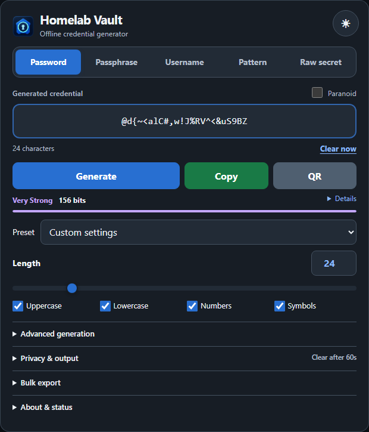

<p align="center">
  
</p>

# Homelab Vault

[](https://github.com/jakubgt/homelab-vault-gen/actions/workflows/tests.yml)
[](https://github.com/jakubgt/homelab-vault-gen/releases/latest)
[](LICENSE)

An offline-first password, passphrase, username, pattern, and raw-secret generator for homelabs. Everything runs in the browser: there is no backend, telemetry, CDN, or outbound application request after the local assets load. It generates credentials for your password manager or infrastructure; it does not store them.

[Features](#highlights) · [Quick start](#quick-start) · [Raw secrets](#raw-secrets) · [CLI](#command-line-use) · [LAN HTTPS](#lan-https-with-caddy-on-a-debian-lxc) · [Security](#security-model) · [Tests](#tests)

<p align="center">
  
</p>

*The screenshot uses disposable demonstration output generated only for documentation.*

## Highlights

- Cryptographically secure randomness from `crypto.getRandomValues`, with rejection sampling to avoid modulo bias.
- Passwords that include every selected character class; custom symbol pools are validated and deduplicated.
- Exact password entropy for the class-constrained output space, plus conservative passphrase and pattern estimates.
- The full 7,776-word EFF large wordlist for passphrases and usernames.
- Printable-ASCII pattern templates such as `[A-Z]{3}-[0-9]{4}`.
- Raw 256- or 512-bit secrets encoded as Hex, Base64, or Base64URL, with exact byte counts.
- Local QR rendering with generous white margins and cancellable bulk TXT/JSON/CSV export with no upload.
- Paranoid Mode that conceals plaintext from both the display and accessibility tree, clears on focus loss, and disables file export and preference saving.
- Clear now, a post-copy countdown, output length checks, lowercase usernames, and built-in or named generation presets.
- A `#paranoid` launch address that activates privacy controls before the first generation and keeps them active after reload.
- Responsive light/dark UI, keyboard-accessible tabs, reduced-motion support, and screen-reader labels.
- Hardened NGINX and Caddy examples with a strict Content Security Policy.
- A dependency-free CLI, runtime-only container packaging, and standalone web app installation on supported browsers.

## Use it

1. Pick Password, Passphrase, Username, Pattern, or Raw secret.
2. Adjust the options. Each generation setting immediately creates one new value.
3. Select **Generate** for another value, **Copy** for the clipboard, or **Show QR** for local transfer.
4. Use **Clear now** whenever you finish. After copying, a countdown shows when the displayed result will clear. The app cannot erase OS clipboard history.

Press <kbd>Space</kbd> outside a form control to generate again. The selected mode, preferences, and named presets are stored in this app's `localStorage` keys unless Paranoid Mode is active. Generated results are not saved there. **Pattern literals are settings:** never enter an existing secret in a pattern. Enabling Paranoid Mode removes this app's saved settings, theme, and presets while preserving unrelated origin storage.

**Generation presets** includes strong passwords, alphanumeric, config-friendly, six-word passphrases, and six-digit PINs. A PIN has much less entropy than the password/passphrase defaults; use it only where a target requires a PIN and limits guessing. You can save up to 20 named presets; saving the same name replaces that preset. Presets save settings, not a generated result.

**Target length limit** is an advisory compatibility check. It does not truncate, reject, or filter random outputs, so the generator's distribution is preserved. Adjust the generation options if the result is too long for the target. Password mode's pool preview and Pattern mode's output length describe the selected constraints.

**Start in Paranoid mode** adds `#paranoid` to the address. Bookmark that address for future private starts. The mode uses the URL fragment, not a stored preference, and conceals each new result until you select Reveal. Moving focus to another window, hiding the tab, or leaving the page clears the result and QR. Browser clipboard permission dialogs can also cause focus loss; generate again after granting access if needed.

**Bulk export:** TXT contains one exact credential per line; JSON contains an array of exact strings. Both are unencrypted. CSV keeps the original values, but spreadsheet applications can interpret formulas, strip leading zeros, or round digits. CSV export requires acknowledgement that you will import the `Credential` column as **Text**. Do not open it directly as a spreadsheet; prefer TXT/JSON for interchange. No apostrophes or tabs are silently added to credentials. The progress indicator and Cancel export button remain responsive during generation.

**About & status** shows the app version, deployed source commit when available, delivery method, and licenses. It makes no network request to check for updates. Remote HTTP shows a warning; use trusted HTTPS for access from another device.

## Raw secrets

Choose **Raw secret**, a byte count, and an encoding. Every byte comes directly from `crypto.getRandomValues`; this mode does not enforce password character classes. Base64 padding and hexadecimal digits represent the same random bytes and do not add entropy.

| Random bytes | Entropy | Hex characters | Base64 characters (padded) | Base64URL characters (unpadded) |
|---|---|---|---|---|
| 32 | 256 bits | 64 | 44 | 43 |
| 64 | 512 bits | 128 | 88 | 86 |

Use the exact size and encoding required by the target application. These are generic random secrets, not SSH keypairs, password hashes, or a replacement for a service's own key-generation procedure. Raw mode shares the normal copy, QR, presets, Paranoid, and bulk-export controls.

## Quick start

### Open the file locally

Download the versioned `homelab-vault-gen-vX.Y.Z.zip` from [the latest published release](https://github.com/jakubgt/homelab-vault-gen/releases/latest), verify it against that release's `SHA256SUMS`, extract it, and open `index.html` in a current browser. The ZIP includes all runtime assets and records its source commit. No npm install or build is required to run it. This is the simplest air-gapped option. Some browsers restrict the modern clipboard API on `file://`; the app will try a legacy local fallback and report if copying fails. Source checkouts can contain features awaiting owner publication in a new release.

You can also clone the repository and open `index.html`. A source checkout displays its version with “source checkout”; packaged and LXC installations display a commit. Checksums detect accidental corruption; obtain the checksum and release through a trusted GitHub connection.

### Automatically verify a download

Save the release ZIP, matching `.manifest.json`, and `SHA256SUMS` together in one directory. From a trusted source checkout or an earlier verified release, run the bundled verifier with Python 3.10 or newer:

```bash
python3 -I scripts/verify-release.py --directory /path/to/downloads --version 2.3.0
```

On Windows, use `python` in place of `python3` and pass your download directory. The command reports success only when both downloaded files match `SHA256SUMS`, the external and embedded manifests agree, and every archived file matches its declared size and SHA-256. It rejects unsafe or duplicate paths and never extracts or executes archive contents. Add `--commit FULL_40_CHARACTER_COMMIT_SHA` to require a reviewed source revision.

To check an extracted copy against the same downloaded release, also pass `--extracted /path/to/extracted`. Extra files in that directory are outside the manifest's guarantees. Release CI runs the verifier automatically before uploading build artifacts, and the owner publisher independently reproduces files and checks uploaded digests before publication. A separate read-only workflow downloads and verifies each published stable immutable release; it can also be run manually for a version tag.

Use a verifier obtained through a trusted channel. Matching checksums establish consistency, not independent authenticity: someone able to replace both the files and their checksums can produce a matching set. A published immutable GitHub release over authenticated HTTPS remains part of the trust boundary.

### Loopback development server

```bash
python3 -m http.server 8000 --bind 127.0.0.1
```

Open <http://127.0.0.1:8000>. This command is for same-machine use only; it does not add TLS or the production security headers.

### Docker Compose

```bash
docker compose up -d
```

Open <http://127.0.0.1:8080>. The container runs unprivileged, drops Linux capabilities, uses a read-only filesystem, and binds to loopback by default.

To change the local port:

```bash
VAULT_PORT=9000 docker compose up -d
```

To intentionally expose the container on every interface:

```bash
VAULT_BIND_ADDRESS=0.0.0.0 docker compose up -d
```

For access from other devices, put the app behind trusted HTTPS. Plain HTTP lets anyone able to modify the response replace the generator code and capture future credentials.

The modern Clipboard API requires a secure context; `crypto.getRandomValues` remains available on HTTP, and the app attempts a legacy copy fallback. HTTPS protects the delivered code as well as enabling the modern clipboard path. See the browser documentation for [Clipboard](https://developer.mozilla.org/en-US/docs/Web/API/Clipboard/writeText) and [Web Crypto](https://developer.mozilla.org/en-US/docs/Web/API/Crypto/getRandomValues).

Useful commands:

```bash
docker compose ps
docker compose logs -f vault-gen
docker compose down
```

For a runtime-only image, multi-platform GHCR publishing, and `docker-compose.image.yml`, see [the container guide](docs/CONTAINERS.md). Image publication is an explicit owner action after a reviewed immutable release; a source merge alone does not make a new registry tag available.

### Install as a standalone app

On a supported browser, open the trusted HTTPS or loopback deployment and use the browser's **Install app** or **Add to Home Screen** command. The manifest provides the new icon, a standalone window, and a Paranoid Mode shortcut where supported. Installation is browser-dependent and is not available from `file://`.

There is no service worker or persistent application cache. An installed hosted app still needs its server when opening or reloading; for disconnected use, download and verify the local ZIP instead. Installing a shortcut does not strengthen the browser's memory or clipboard guarantees. See [browser installation requirements](https://developer.mozilla.org/en-US/docs/Web/Progressive_web_apps/Guides/Making_PWAs_installable).

### Credentials in Docker Compose

Keep the generated secret unchanged. Escaping depends on where you paste it:

- **Inline Compose YAML:** Compose interprets dollar signs in values. Use `$$` for each literal `$`, for example `APP_SECRET: "example$$literal"` delivers `example$literal` to the container.
- **Compose `.env`:** single-quoted values are literal, for example `APP_SECRET='example$literal'`. Doubling dollar signs is not a universal `.env` transformation.
- **Other configuration formats:** follow that application's quoting rules. The config-friendly password preset avoids `$` and other common metacharacters but does not replace format-specific validation.

The examples are disposable demonstration values. [Docker documents YAML interpolation](https://docs.docker.com/reference/compose-file/interpolation/) and [`.env` quoting](https://docs.docker.com/compose/how-tos/environment-variables/variable-interpolation/) separately.

### Homepage dashboard

Copy `assets/icon-192.png` into a Homepage directory mounted at `/app/public/icons` as `homelab-vault.png`, restart Homepage, then add an entry to `services.yaml`:

```yaml
- Security:
    - Homelab Vault:
        icon: /icons/homelab-vault.png
        href: https://192.168.1.50
        description: Local credential and raw-secret generator
```

Use your actual trusted HTTPS address. Serve the copied icon from the dashboard itself: the generator's same-origin resource policy deliberately restricts cross-origin embedding. No credential, API token, or widget is needed. See [Homepage services configuration](https://gethomepage.dev/configs/services/).

## Command-line use

With Node.js 22 or newer, use the same generation engine without installing packages:

```bash
node cli.cjs --help
```

See [the CLI guide](docs/CLI.md) for modes, byte encodings, bounds, and piping. Output is plaintext; protect terminals, destinations, and shell pipelines accordingly.

## LAN HTTPS with Caddy on a Debian LXC

This is the easiest LAN-only setup: each device opens the LXC's IPv4 address directly, such as `https://192.168.1.50`. It needs no local DNS, hostname, or hosts-file entry.

Caddy creates a private local certificate authority (CA). Each Windows computer, phone, tablet, or browser-specific trust store must trust its public `root.crt` once. Until then, the browser warning means the connection is not authenticated; do not generate credentials by clicking through it.

### Before you start

- Create and start a Debian LXC with internet access. Run the commands below as `root` inside that container.
- Give the LXC an address that will not change, either with a static address in Proxmox or a DHCP reservation in the router. The installer verifies the address you enter, but it cannot reserve it for you.
- Make sure the intended computers and phones can reach the LXC. Guest Wi-Fi isolation or VLAN firewall rules may block it.

### 1. Run the installer

Copy this block into the LXC console:

```bash
apt-get update &&
apt-get install -y ca-certificates curl &&
curl --proto '=https' --tlsv1.2 --fail --silent --show-error --location \
  --output /root/install-homelab-vault.sh \
  https://raw.githubusercontent.com/jakubgt/homelab-vault-gen/v2.3.0/install-caddy-lxc.sh &&
chmod 0700 /root/install-homelab-vault.sh &&
/root/install-homelab-vault.sh
```

The installer shows the LXC's addresses and asks for the stable IPv4 address without its CIDR suffix: enter `192.168.1.50`, not `192.168.1.50/24`.

It then installs the required Debian tools, verifies that v2.3.0 is a published stable immutable release and that its exact commit belongs to protected `main`, and compares the downloaded installer with that revision. Python 3 parses the release metadata; it is not an application runtime dependency. The installer installs Caddy from its [official Debian repository](https://caddyserver.com/docs/install), stages the same revision's assets, validates the IP-specific configuration, enables the service, checks HTTPS locally, and prints the site URL and CA file digest. A lock prevents concurrent activation/rollback. It refuses to overwrite an unrelated Caddy configuration or web root and restores the previous site, version metadata, and Caddy configuration if startup fails. Existing Caddy CA data is preserved.

**Upgrading from v2.2.0 or earlier:** use the download-and-run block above once. The old `homelab-vault-update` command refuses the new protocol, so it cannot perform this migration itself. Enter the existing LXC IPv4 address when prompted. The installation preserves the Caddy CA and replaces the maintenance command with the hardened updater. An old `/opt` source checkout is left untouched; the new updater uses a temporary checkout.

### 2. Allow LAN access

If the Proxmox or Debian firewall is enabled, allow inbound TCP port `443` to this LXC from the trusted LAN. UDP port `443` is optional for HTTP/3. Do not forward either port from the internet.

Use the exact URL printed by the installer, such as `https://192.168.1.50`.

### 3. Trust the CA on each device

The installer temporarily makes the public certificate available at:

```text
https://LXC_IP/caddy-root.crt
```

It also prints the public certificate file's SHA-256 digest in the trusted LXC console. The certificate is public, but verifying the file prevents you from importing an attacker's replacement. Never copy or expose `root.key`.

#### Windows 11

In PowerShell, download the certificate and display the file's SHA-256 digest. `--insecure` is used only for this first download because the CA is not trusted yet.

```powershell
$VaultIp = Read-Host 'Enter the LXC IPv4 address'
curl.exe --insecure --fail --show-error `
  "https://$VaultIp/caddy-root.crt" `
  --output .\caddy-root.crt
certutil -hashfile .\caddy-root.crt SHA256
```

Compare that value with `CA file SHA-256` still visible in the LXC console. If they differ, delete the file and do not import it. If they match, open PowerShell **as Administrator** in the same folder and run:

```powershell
certutil -addstore -f "Root" .\caddy-root.crt
```

Completely close and reopen the browser. Firefox may require a separate import under **Settings > Privacy & Security > Certificates > View Certificates > Authorities**. The Windows command follows Microsoft's [`certutil -addstore` documentation](https://learn.microsoft.com/en-us/windows-server/administration/windows-commands/certutil).

#### iPhone or iPad

Transfer the digest-verified `caddy-root.crt` from the Windows computer through a trusted method and open it on the device. Promptly open **Settings > Profile Downloaded** and select **Install**; Apple may remove an uninstalled downloaded profile after eight minutes. Then enable it under **Settings > General > About > Certificate Trust Settings**. If Stolen Device Protection blocks profile installation away from a familiar location, follow Apple's prompt and re-enable the protection afterward. Apple documents both [profile installation](https://support.apple.com/en-us/102400) and the required [full-trust setting](https://support.apple.com/en-us/102390).

#### Android

Transfer the same verified file to the device. Search Settings for **Install a certificate**, choose **CA certificate**, and select `caddy-root.crt`. Menu names vary by manufacturer and Android version; a screen lock may be required. Google provides [Pixel certificate instructions](https://support.google.com/pixelphone/answer/2844832).

Some browsers and apps use their own trust stores or deliberately ignore user-installed CAs. If a browser still warns, import the root into that browser's Authorities store. Caddy explains this behavior in its [local HTTPS guidance](https://caddyserver.com/docs/running#local-https-with-systemd).

After all clients are configured, remove the temporary public download from the LXC:

```bash
rm -f -- /srv/homelab-vault/caddy-root.crt
```

The original CA remains protected under `/var/lib/caddy`. Keep that directory in secured LXC backups; rebuilding without it creates a new CA that every client must trust again.

### 4. Update or change the IP

The installer installs one maintenance command. Run these as `root` in the LXC:

```bash
homelab-vault-update status
homelab-vault-update check-update
homelab-vault-update
```

`status` shows the installed version, full commit, IP, and Caddy state. `check-update` asks GitHub for its latest published stable release and reports its exact commit without changing the deployment. Release selection requires immutable metadata: drafts, prereleases, mutable releases, and bare Git tags are rejected. Before checking out a candidate or executing its installer, the updater verifies that GitHub reports `main` as protected, fetches that branch's complete history, and requires the candidate to be on its first-parent history. A changed branch tip or failed API request stops the update. Installer and assets use the same verified commit.

To select a reviewed version explicitly, use `homelab-vault-update v2.3.0`. A deliberate commit selection uses `homelab-vault-update update FULL_40_CHARACTER_COMMIT_SHA`; it still requires protected-main history and the hardened protocol 2 (v2.2.1 onward), but does not require a release record. It cannot execute the older protocol 1 installers. Enter the current LXC IPv4 address when prompted. To change the IP without upgrading, rerun the currently deployed version explicitly. The updater stages runtime files, revalidates Caddy, and keeps the existing CA. Root-only deployment metadata lives with the site at `/srv/homelab-vault/.homelab-vault-deployment` and is hidden by Caddy.

Repository ownership, protected-main administration, and authenticated GitHub delivery remain trusted. These checks do not defend against takeover of the owner account or modification of the installed updater by an attacker with root access.

### Troubleshooting

```bash
systemctl --no-pager --full status caddy
journalctl -u caddy -n 100 --no-pager
```

- A timeout normally points to the IP, firewall, VLAN routing, or Wi-Fi client isolation.
- An authority warning means the CA is not trusted by that operating system or browser.
- A name-mismatch warning means the client used a different IP from the one entered during installation.
- To make the public CA download available again, rerun `homelab-vault-update`.

The repository `Caddyfile` keeps commented examples for same-machine localhost and a public domain. The installer uses the default LAN-IP block. This deployment serves files directly from `/srv/homelab-vault`; it does not use `docker-compose.yml`.

## Security model

### What the app provides

- Random choices come from the browser's operating-system-backed Web Crypto source.
- Generated values stay client-side unless you copy, scan, download, or otherwise share them.
- No application code makes network requests.
- Served deployments use CSP, clickjacking protection, MIME sniffing protection, restrictive Permissions Policy, and no-store caching headers.
- Password entropy counts only outputs that satisfy the selected class guarantees.

### What it cannot guarantee

- **Authentic delivery:** Remote clients must receive the HTML and JavaScript over trusted HTTPS. CSP cannot help if an attacker replaces the entire HTTP response.
- **JavaScript memory erasure:** The mutable working buffer is overwritten and the DOM is cleared on supported paths, but JavaScript strings, browser internals, QR canvases, Blobs, and garbage-collected copies cannot be proven erased.
- **Clipboard deletion:** Clipboard managers and OS history can retain copied values. The timer clears the displayed result, not the operating system's clipboard.
- **Safe endpoints:** Malware, malicious extensions, screen capture, developer tools, or a compromised browser can read generated values.
- **QR privacy:** A QR code is plaintext in visual form. Nearby people and the scanning app can read it.
- **Downloaded-file secrecy:** Bulk exports are unencrypted plaintext and may remain in download history, backups, or synced folders.
- **Universal crack time:** The meter assumes an average search at 100 billion guesses/second. Actual rates depend heavily on the target's hash, KDF, rate limits, and attacker.

For sensitive use, prefer a trusted local file or HTTPS deployment, a clean browser profile, and a password manager that can generate and store credentials directly.

## Pattern syntax

Pattern mode supports a small template language, not full regular expressions:

| Syntax | Meaning |
|---|---|
| `[A-Z]` | One character from a range |
| `[abc]` | One character from a listed set |
| `{4}` | Repeat the preceding token four times |
| `-` or `_` | Include a literal character |
| `\[` or `\{` | Include a reserved character literally |

Patterns accept printable ASCII, up to 512 input characters and 1,000 output characters. Descending ranges and zero repetitions are rejected with an inline error.

## Tests

The app itself has no package installation or build step. Core/repository tests require Node.js 22 or newer and no installed dependencies:

```bash
node --check core.js
node --check app.js
node --check test.js
node test.js
node test-core.cjs
node tests/test-cli.cjs
```

For behavioral browser tests, install development-only tools and browser binaries:

```bash
npm ci
npx playwright install --with-deps
npm run test:all
```

Playwright covers Chromium, Firefox, and WebKit using a loopback test server with the production NGINX headers. The tests exercise concealment/accessibility, focus and page lifecycle, clipboard races and failure paths, countdowns, settings, presets, exact export bytes, cancellation, and QR decoding. Only disposable sample values are used. The older repository integration assertions check static configuration; they complement these behavioral tests.

On Linux, run the installer harness and release tests with:

```bash
dash -n install-caddy-lxc.sh
dash tests/test-installer.sh
python3 tests/test-release.py
python3 tests/test-publish-release.py
python3 tests/test-repository-security.py
python3 tests/test-container.py
python3 tests/test-verify-release.py
```

The shell harness exercises actual temporary-directory rollback and real temporary Git histories, with network/service/package operations replaced by fixtures. It rejects off-main installers before execution and tests release metadata failures. GitHub Actions checks Node.js 22 and 24, the three browser engines, installer syntax and rollback, actual container startup and response headers, deterministic packaging, and owner-publishing/security-configuration guards. The required `test` check passes only when every validation job succeeds. Dependabot checks GitHub Actions, Docker Compose, and npm development dependencies monthly. A version.js change on main runs the full suite and prepares release artifacts with read-only repository permissions; publication is manual.

For reproducible high-assurance deployments, set `VAULT_IMAGE` to the same image pinned by a multi-platform digest (`nginxinc/nginx-unprivileged@sha256:...`) after verifying that digest in your registry.

## Manual releases and repository protections

The owner publishes releases after reviewing the exact tested `main` commit. CI cannot publish a release or create a version tag. The required GitHub setup uses separate creation and immutability rules: only repository administrators may create version tags, and no actor may update or delete them through a bypass. New published releases must be immutable.

These GitHub settings are external to Git and must be configured separately; committing a ruleset JSON file does not enable it. The owner can use `python -I scripts/configure-repository-security.py --apply`, or import the two files under `.github/security/` in GitHub and enable release immutability. The default command checks the actual remote settings without changing them. See [the owner release guide](docs/RELEASING.md) for setup, verification, and publishing instructions.

## Project layout

| Path | Purpose |
|---|---|
| `index.html`, `styles.css`, `app.js` | Accessible browser UI and state handling |
| `core.js` | Shared RNG, all credential generators, entropy, symbols, and pattern parsing |
| `cli.cjs`, `docs/CLI.md` | Dependency-free Node.js interface and usage guide |
| `version.js` | Local version/source metadata; populated with a commit during packaging/deployment |
| `words.js` | Vendored EFF large wordlist |
| `qrcode.min.js` | Vendored local QR renderer |
| `docker-compose.yml`, `nginx.conf` | Unprivileged container deployment |
| `Dockerfile`, `docker-compose.image.yml`, `docs/CONTAINERS.md` | Runtime-only image, image deployment, and owner publication |
| `manifest.webmanifest`, `assets/icon-192.png`, `assets/icon-512.png` | Standalone installation metadata and icons |
| `Caddyfile` | Required-IP LAN HTTPS template and deployment alternatives |
| `install-caddy-lxc.sh` | Guided Debian LXC installation and update script |
| `test.js`, `test-core.cjs` | Zero-dependency core and repository checks |
| `tests/browser.spec.js`, `playwright.config.js` | Browser regressions and engine matrix |
| `tests/test-installer.sh`, `tests/test-release.py` | Rollback and release packaging tests |
| `scripts/build-release.py` | Deterministic offline ZIP and checksum/manifest builder |
| `scripts/verify-release.py` | Read-only checksum, archive, and optional extracted-file verification |
| `scripts/publish-release.py` | Owner-only manual publishing with protected-main, test, tag, and immutability checks |
| `scripts/configure-repository-security.py`, `.github/security/` | Explicit GitHub protection setup and read-only verification |
| `docs/RELEASING.md` | Owner release procedure and trust boundaries |
| `docs/screenshots/homelab-vault.png` | App screenshot with disposable demo output |
| `CHANGELOG.md` | Release notes and migration information |

To build a release locally, run `python3 -I scripts/build-release.py --version 2.3.0 --commit FULL_40_CHARACTER_COMMIT_SHA --output dist/v2.3.0` from a clean checkout of that commit. Version declarations must agree. The read-only release workflow validates the revision and prepares the archive, checksums, and manifest. The owner publishes them explicitly using the release guide. See [CHANGELOG.md](CHANGELOG.md) for v2.3.0 changes.

See [THIRD_PARTY_NOTICES.md](THIRD_PARTY_NOTICES.md) for source, digest, and license information for vendored assets, and [SECURITY.md](SECURITY.md) for vulnerability reporting.

## License

Homelab Vault is released under the [MIT License](LICENSE).
